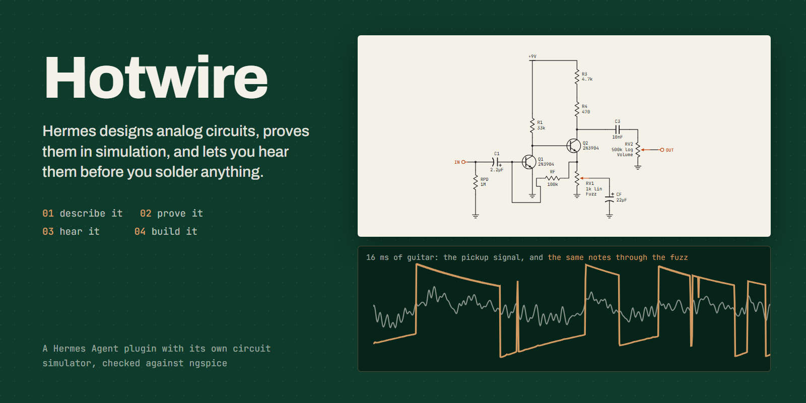
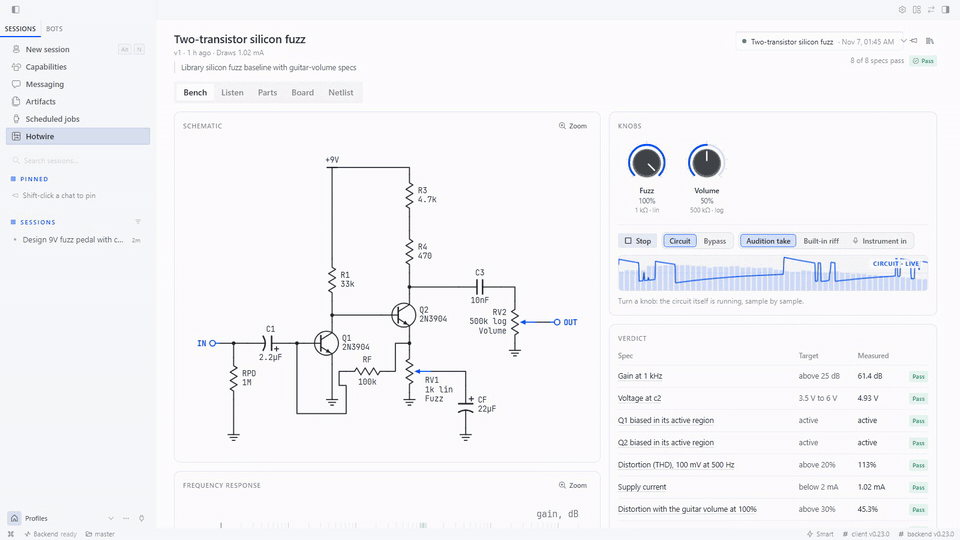
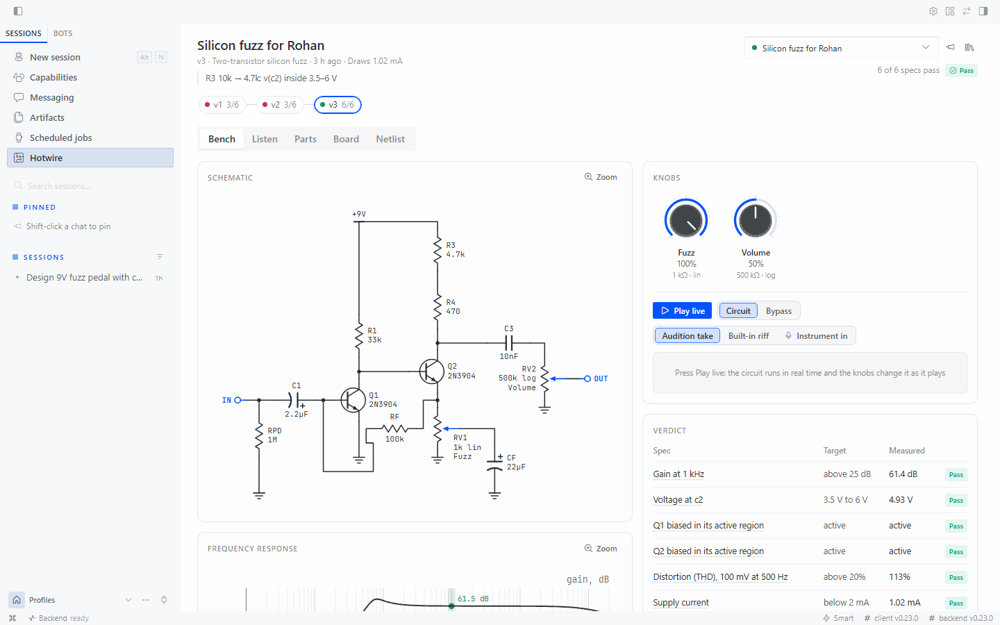
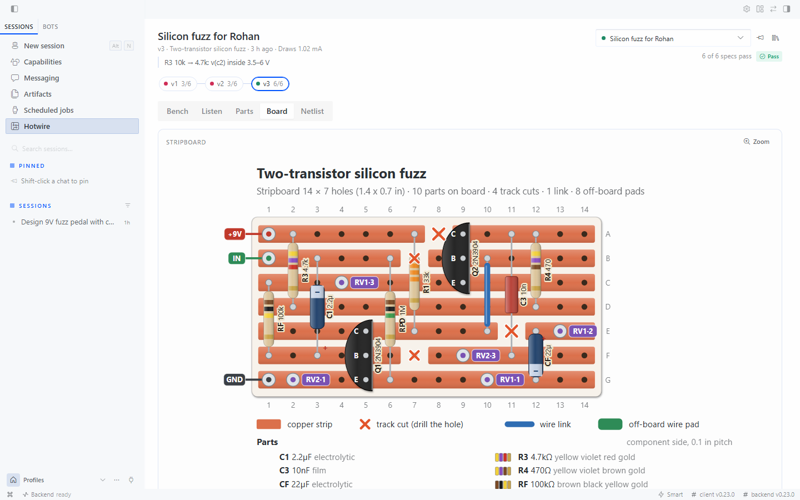
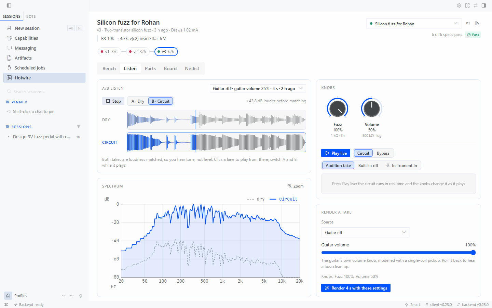

<p align="center"></p>

# Hotwire

**Hermes designs analog circuits from plain English, proves them in simulation, and lets you hear and play through them before you solder anything.**

Ask for *"a 9 V fuzz that cleans up when I roll back my guitar's volume"*. Hermes writes the circuit, measures it against the numbers you care about (gain, tone, distortion, current draw, part stress), fixes what fails, and plays your guitar riff through it. Then it shows how many real-world builds would work, gives you a parts list, and lays the circuit out on a stripboard you can solder tonight.

**Hermes can now design hardware it can prove.** Guitar pedals are the demo; the same bench checks filters, amplifiers, LED drivers and bias networks. On November 6, 2026, none of the 1,063 plugins in the Hermes catalog simulated circuits.

The model only proposes designs; every claim it makes is measured. Hotwire ships its own circuit simulator, written for this plugin and checked against ngspice, for one reason: the same equations then run in your browser, sample by sample, so the Desktop Bench can play a circuit live while you turn its knobs, with nothing else to install.

<p align="center"></p>

<p align="center"><i>Turning a knob on a fuzz Hermes designed, while the circuit plays live in Hermes Desktop. The specs re-check as it turns.</i></p>

## Try asking

| If you're… | ask Hermes |
|---|---|
| learning electronics | *"Explain what every part in this common-emitter amp does, with numbers."* (`circuit_explain` nudges each part and measures the effect) |
| debugging a build | *"Here's my netlist. Why does it clip early, and what's the smallest fix?"* |
| reading an old schematic | *"Here's a photo of a 1970s magazine fuzz. Turn it into a circuit and let me hear it."* |
| designing a filter | *"A 3 kHz second-order low-pass for a 3.3 V microcontroller's audio output, flat to 1 kHz, from parts I can buy."* |
| building a pedal | *"Make the library overdrive smoother on top, check it survives real parts, and give me the stripboard."* |
| chasing a tone | *"Here's a DI take and the same take through my pedal. What knob settings get me that sound?"* |

## Install

```bash
hermes plugins install hotwire                  # from the plugin catalog
hermes plugins install RohanGlitched/hotwire    # or straight from GitHub
```

Hermes asks for consent to install one Python dependency (`numpy`). Then turn on the Desktop half in **Capabilities → Plugins** to get the Bench pane, and ask Hermes about any circuit.

## What it can do

| Tool | What it does |
|---|---|
| `circuit_check` | Parses the netlist, runs an electrical rule check, solves the operating point, measures every spec, checks every part against its ratings, draws the schematic and Bode plot, and saves a new version so the design history is kept. |
| `circuit_audition` | Plays a guitar riff, bass line, drum loop or your own WAV through the simulated circuit with the real nonlinear device models. Guitar sources go through a modelled pickup, volume pot and cable, so a fuzz cleans up when you roll the guitar volume back, as a real one does. Writes loudness-matched A/B files and a spectrum, and can sweep any knob (or the guitar's volume) while it plays. |
| `circuit_tune` | Picks standard E-series values for the parts you name so the specs pass with the most margin. |
| `circuit_explain` | Measures what each part does: nudges every part 10% and reports which specs it moves. |
| `circuit_match` | Give it a dry take and the same take through your real pedal: it finds the knob settings that reproduce the tone, or ranks the library circuits by how close they get. |
| `circuit_yield` | Monte Carlo over real part tolerances: the percentage of builds that meet every spec, and which parts drive the failures. |
| `circuit_bom` | Parts list grouped by value and snapped to preferred values, with semiconductor part names, packages, pot tapers and IC sockets; for a 9 V pedal it adds the jacks, footswitch, LED, enclosure and battery snap. |
| `circuit_build` | An automatically placed stripboard layout with track cuts and wire links, checked against the netlist, plus a numbered build order. |
| `circuit_simulate` | Raw DC, AC or transient runs with plots. |
| `circuit_export` | KiCad netlist, a self-contained SPICE deck for ngspice or LTspice, the schematic SVG, or JSON. |
| `circuit_library` | 17 reference circuits verified against ngspice: filters, transistor, JFET and MOSFET stages, overdrive, clipping, silicon and germanium fuzz, tone stacks, treble booster, wah, octave, oscillator, power filter. |

The `/hotwire` slash command lists the library and your designs and checks a netlist file from any chat surface. A bundled skill, `hotwire:analog-design`, teaches the agent the loop: pin the target down in numbers, start from a proven topology, check, tune, test yield, listen, and hand over the build.

## The Bench (Hermes Desktop)

<p align="center"></p>

Turn on the Desktop half and Hotwire adds a **Bench** page and a side pane that follow the agent as it works:

- **Version timeline.** Every check is a version (v1 ✗ 3/6 → v2 ✗ → v3 ✓ 6/6) with the note the agent wrote. Click one to see it.
- **Knobs.** One pedal-style knob per pot. Drag, scroll or use the arrow keys; the specs and the Bode plot update as you turn.
- **Play live.** The circuit runs sample by sample in an AudioWorklet in your browser, the same equations as the Python engine (matched to within 0.006% RMS across 27 test circuits), so turning a knob changes the sound while it plays. Feed it the demo riff, the agent's audition take, or your own instrument.
- **Listen.** A/B the dry take and the circuit, loudness-matched, switching instantly while it loops.
- **Parts, Board, Netlist.** The BOM, the stripboard with zoom and build steps, and the netlist of the selected version.
- **Chat cards.** Schematic + verdict, audio A/B and board cards render inline in the transcript, each with "Open in Bench".

<p align="center"> </p>

## Specs are numbers, not adjectives

Specs live inside the netlist as comments that other SPICE tools ignore:

```spice
*@ title Warm op-amp overdrive
*@ in VIN
*@ out out
*@ supply VCC
*@ pot RV1 fb w out 500k taper=log pos=0.5 label="Drive"
*@ spec gain_db(1k) > 20
*@ spec f3db_low < 80
*@ spec thd(1k, 0.2) > 8%
*@ spec supply_current < 8m
```

Metrics: `gain_db(f)`, `phase(f)`, `fc`, `f3db_low`, `f3db_high`, `peak_db`, `zin(f)` (input impedance), `v(node)`, `i(part)`, `p(part)`, `supply_current`, `battery_hours(mAh)`, `thd(f, vin)`, `vout_peak(f, vin)`, `gain_tran(f, vin)`, `headroom(f)`, `region(Q1) == active`, and through a modelled guitar `thd_gv(f, vin, volume)`, `gain_gv(f, vin, volume)` and `cleanup_vol(f, vin, thd%)` (the guitar-volume setting where it cleans up). Each result comes back with a plain label, the measured value, the margin and one sentence, so a failure explains itself.

A pass has to be earned. A check fails if the DC operating point doesn't converge, if the circuit latches or oscillates after a 10 µV kick (so a small-signal gain would be meaningless), if an op-amp's supply pins are swapped, if a transistor is wired backwards, or if any part exceeds its ratings.

## Accuracy

The simulator is checked against **ngspice 42** on 19 circuits (diode clippers, common-emitter, JFET and MOSFET stages, a two-transistor fuzz, op-amp clippers, a germanium PNP stage, an LC band-pass, a tone stack, a class-B follower, a CMOS inverter, a P-channel high-side switch, a rectifier and more), with the same parameters on both sides:

| quantity | target | worst measured |
|---|---|---|
| DC node voltages | within 1% or 1 mV | 0.35 µV |
| AC gain | within 0.1 dB | 0.0000006 dB |
| −3 dB frequencies | within 1% | 0.000007% |
| transient waveform (RMS error) | within 2% | 1.75% (a P-MOSFET high-side switch at a 2 µs step; 0.10% at 0.1 µs) |
| guitar-rate audio at 48 kHz | within 2% | 1.44% for the two-transistor fuzz; one op-amp driven hard into its rails reaches 2.41% at 48 kHz (0.16% at 96 kHz, which the THD specs use) |
| 1 s of 48 kHz audio through a two-transistor fuzz | under 10 s | 2.6–3.6 s on a laptop |

All 17 reference circuits converge and pass every one of their specs in both ngspice and Hotwire, and they hold up under Monte Carlo with real part tolerances: 96.5–100% of virtual builds meet every spec (200 builds per circuit, or 49–60 for circuits whose specs need a time-domain run per build; per-circuit yields with 95% intervals are in docs/LIBRARY.md). Analytic checks cover dividers, RC corners and step responses, a hand-calculated common-emitter bias point, op-amp closed-loop gain and bandwidth, LC resonance and Q, diode drops, JFET saturation current and an oscillator that starts from its initial condition. The full tables are in [docs/VALIDATION.md](docs/VALIDATION.md) and [docs/LIBRARY.md](docs/LIBRARY.md).

## How it works

```
plain English ──► Hermes (+ hotwire:analog-design skill)
                    │ writes SPICE with *@ annotations (specs, knobs, in/out, supply)
                    ▼
  circuit_check ── parser ─ ERC ─ DC operating point ─ AC sweep ─ transient ─ part stress
       │                        (Newton–Raphson with junction limiting, gmin and source stepping;
       │                         trapezoidal integration; dense MNA in numpy)
       ├─ circuit_explain   sensitivity of every spec to every part
       ├─ circuit_tune      coordinate search over E12/E24 values
       ├─ circuit_yield     Monte Carlo over tolerances and transistor spread
       ├─ circuit_audition  sample-by-sample nonlinear simulation of a guitar through a modelled
       │                    pickup, volume pot and cable, loudness-matched A/B
       ├─ circuit_match     third-octave + clipping-character fit of knobs to a recording
       ├─ circuit_bom / circuit_build / circuit_export   parts, stripboard, KiCad/SPICE
       ▼
  design history on disk (v1 ✗ → v2 ✗ → v3 ✓) ──► Desktop Bench (live knobs, A/B, live play)
```

- **The simulator** (`engine/mna.py`, `devices.py`, `analyses.py`) is modified nodal analysis written for this plugin: resistors, capacitors, inductors, sources, controlled sources and switches; Shockley diodes with series resistance and junction capacitance; BJTs with Ebers–Moll transport and Early effect, plus Gummel–Poon high-injection and base-leakage terms when a pasted `.model` sets them (the built-in parts use a simpler fit, see docs/LIBRARY.md); Shichman–Hodges JFETs; level-1 N and P MOSFETs with body effect; and an op-amp macromodel with finite gain, a dominant pole from the gain–bandwidth product, output resistance, rail limits (with anti-windup, so it recovers from clipping like a real op-amp) and quiescent current. Netlists can use `.subckt`/`.ends` (flattened at parse time) and `.param` with `{expressions}`; `.include` is refused, because Hotwire never reads files a netlist names. Device equations follow SPICE level-1 conventions, so a Hotwire netlist exports to ngspice unchanged.
- **Specs** (`engine/specs.py`) are measured, not estimated: the AC sweep runs 1 Hz to 200 kHz at 60 points per decade and then zooms in on every peak and −3 dB crossing (a Q of 900 resolves to 0.001 dB), THD comes from an FFT over whole cycles after the circuit settles, and headroom is a bisection on THD.
- **Parts** (`engine/parts_data.py`) carry manufacturer SPICE parameters and absolute-maximum ratings, so the stress check knows a 2N3904 from a 1N4148.
- **The design store** (`engine/store.py`) keeps every version's netlist, verdict, plots and audio, so the agent and the Desktop Bench can show how a design evolved.

## Privacy and safety

- Everything runs locally. Hotwire makes no network calls and stores no credentials.
- It writes designs, plots and audio only under Hermes' plugin data folder (`<HERMES_HOME>/plugin-data/hotwire/`), and reads a file only when you or the agent name a `.cir` netlist or a `.wav` to play through a circuit.
- The Desktop half talks only to Hotwire's own backend routes.
- Hotwire is for low-voltage electronics (batteries, 9–24 V adapters, USB). The skill tells the agent not to design mains-powered circuits.

## Limits

Hotwire is honest about what it doesn't model:

- Part ratings (power, voltage, current) are checked at the idle operating point, not at signal peaks.
- Device models are SPICE level 1 at 27 °C (MOSFETs: level 1 only, no Meyer gate capacitance): no temperature drift, no noise or hum analysis, no high-frequency BJT effects (excess phase, split base-collector capacitance). The op-amp macromodel has one pole and no slew-rate limit.
- `process_audio` runs at the audio sample rate without oversampling, so hard clippers alias a little at 48 kHz. Spec measurements use 96 kHz where it matters.
- Germanium parts and some JFETs are fitted to datasheet curves, not manufacturer models; real germanium transistors vary much more than any model.
- The guitar model is a typical single-coil, humbucker or P-90 through a 500 kΩ audio-taper pot and 3 m of cable. Your guitar will differ.
- Stripboard layouts are compact, but not provably optimal; op-amp boards need a few wire links. Footprints assume 0.4 in resistor spacing and 5 mm capacitors, so large electrolytics or metal-can transistors may need a hole of clearance. Check pinouts against the datasheet of the exact part you buy.
- Tone matching compares long-term spectra and clipping character. It finds knob settings, not schematics, and says how close it got.
- Everything is simulated. A pedal built from a Hotwire layout should behave as simulated, but nothing replaces a multimeter and a first power-up with a current-limited supply.

## License

MIT © Rohan Borade
